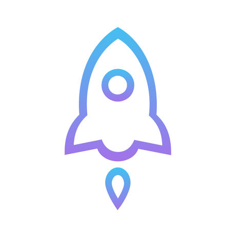
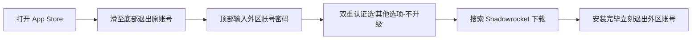

# 🚀 小火箭 (Shadowrocket) 免费下载与美区 Apple ID 账号获取指南

**2026 最新美区 Apple ID 共享/独享账号 · 已购小火箭正版快速安装 · 账号切换与防锁机安全教程**

  <!-- AUTO_UPDATE_BADGE_START --><!-- AUTO_UPDATE_BADGE_END -->
  
  
  
  

---

## 📢 每日更新看板（实时维护状态）

> [!TIP]
> - 🟢 **今日账号状态**：**【已更新可用 · 实时轮换】**（每日定期检测，账号池全天候维护补号）
> - 🔄 **更新机制**：每日持续维护，若遇到苹果官方临时风控锁定，网站后台将自动补号轮换。
> - 📅 **最新同步日期**：`<!-- AUTO_UPDATE_DATE_START -->2026-11-08<!-- AUTO_UPDATE_DATE_END -->`（<!-- AUTO_UPDATE_CN_START -->2026年11月08日<!-- AUTO_UPDATE_CN_END -->）
> - 🛡️ **安全第一**：请认准正规入口，**切勿将外区公共账号登录至手机【系统设置 - iCloud】**！

---

## 🌐 官方入口（同站双域名 · 点击直达）

为保障国内不同省份及运营商网络顺畅访问，站点配置了双域名解析，两端数据实时互通，任选其一均可极速进入：

  
  &nbsp;&nbsp;&nbsp;&nbsp;
  

* 🔗 **主域名（官网首页，多类账号选购与免费共享）**：[https://applp.com](https://applp.com)
* 🛒 **副域名（小火箭 Shadowrocket 已购账号直达）**：[https://id.ningmengid.com/item/69](https://id.ningmengid.com/item/69)

---

## 📌 为什么需要美区 / 外区 Apple ID？

由于国内 App Store（国区）早就下架了 **Shadowrocket（小火箭）** 以及相关网络工具软件，在不越狱的前提下，在 iPhone 或 iPad 上安装正版小火箭的唯一官方安全途径是：

👉 **在 App Store 登录已在美区或其他外区购买过该软件的 Apple ID，进入商店直接下载正版。**

---

## ⚖️ 共享账号 vs 独享账号（对比选型）

| 对比维度 | 免费共享账号 (Public Shared ID) | 美区独享账号 (Private Exclusive ID) |
| :--- | :--- | :--- |
| **获取成本** | 免费提供 / 极低门槛 | 独立购买，终身独享 |
| **使用权限** | 仅限下载已购免费/指定软件 | 完整所有权，可修改密码、密保、绑定手机 |
| **稳定性** | 易因多人同时登录触发苹果风控锁定 | 独享稳定，不受他人滥用影响 |
| **后续更新** | 账号失效后无法直接静默更新 | 随时随地自由更新应用，体验与国区一致 |
| **支持设备** | 建议单台设备临时下载 | 手机、平板、电脑均可绑定多设备 |
| **适用人群** | 偶尔临时安装、短期尝鲜体验 | 长期稳定使用、需要定期更新应用的用户 |
| **获取途径** | [网站首页免费专区 (applp.com)](https://applp.com) | [小火箭独享已购专页 (item/69)](https://id.ningmengid.com/item/69) |

---

## ⚠️ 登录前必读：防锁机三大安全铁律

> [!CAUTION]
> ### 🚨 绝对禁止在「系统设置」或「iCloud」中登录共享账号！
> 1. **唯一安全位置**：只打开桌面上的 **「App Store」**（蓝底白字图标）登录。
> 2. **切勿登录 iCloud**：若将公共账号填入手机「设置 -> Apple ID」，一旦账号触发苹果保护锁定，您的设备将无法注销，**直接变砖**！
> 3. **装完立即退出**：软件安装完毕后，请立即回 App Store 退出外区账号，换回您自己的日常账号，已下载的软件完全不影响使用。

---

## 📲 小火箭 (Shadowrocket) 标准下载 6 步流程

1. **进入商店**：打开 iPhone / iPad 桌面上的 **「App Store」**，点击右上角个人头像。
2. **退出原账号**：滑至屏幕最底部，点击 **「退出登录 / Sign Out」**。
3. **输入账号密码**：滑回页面顶部，输入您获取到的外区已购小火箭账号及密码，点击「登录」。
4. **跳过双重认证（关键步骤）**：
   - 当屏幕弹出「Apple ID 安全 / 双重认证」页面时：
   - **千万不要点“继续”！**
   - 请点击下方的 **【其他选项】** -> 选择 **【不升级】**。
   - *(注：如果点了继续绑定自己手机号，会造成账号锁定或绑定冲突)*
5. **下载正版软件**：
   - 登录成功后，商店将自动切换至美区语言环境；
   - 在搜索栏输入 `Shadowrocket`，认准 **四边形白色小火箭图标**（开发者为 *Pan modal / Shadowlaunch Technology*），点击右侧云朵或获取图标下载；
   - 或点击右上角头像 -> 进入 **【已购项目 (Purchased)】** 找到 Shadowrocket 直接点击下载。
6. **及时退出账号**：
   - 观察手机桌面，小火箭图标安装进度完成后；
   - 立即返回 App Store，滑至最底部点击 **「退出登录」**，换回您本人的国区日常账号即可。

---

## 🛠️ 常见故障排查与 FAQ

### Q1：提示“Apple ID 已锁定”或“此账号已被停用”？
- **原因**：公共共享账号短时间内异地登录人数过多，触发了苹果官方的安全防护机制。
- **解决办法**：请勿在手机上反复强行重试，直接前往 [主域名 (applp.com)](https://applp.com) 或 [直达专页 (item/69)](https://id.ningmengid.com/item/69) 获取刚刚更新补货的新账号。

### Q2：以前下的小火箭提示更新，要求输入旧账号密码？
- **原因**：iOS 机制规定“应用更新严格校验当时下载该应用的 Apple ID”。
- **解决办法**：
  1. 打开手机中的小火箭，导出并备份好自己的节点配置或订阅链接；
  2. 将手机桌面上旧版小火箭长按删除卸载；
  3. 按照上述教程重新获取一个可用账号，重新下载安装最新版本即可。

### Q3：在 App Store 里搜不到 Shadowrocket 怎么办？
- **原因**：当前 App Store 仍处于国区商店，说明账号并未成功登录或地区切换未刷新。
- **解决办法**：关闭 App Store 后台重新打开；若仍未切换，先进入已购项目 (Purchased) 查看是否存在已购记录。

### Q4：提示需要双重验证码 / 发送验证码到受信任设备？
- **原因**：部分公共号可能因其他用户误操作开启了验证保护。
- **解决办法**：共享号若出现验证码阻碍，请直接更换下一组账号使用，或选用独享账号彻底避免此类困扰。

### Q5：为什么下载时提示“无法连接到 App Store”？
- **原因**：本地网络与苹果外区服务器连接延迟或 DNS 污染。
- **解决办法**：尝试切换 Wi-Fi 与 5G/4G 蜂窝网络，或进入「设置 -> Wi-Fi -> 配置 DNS」临时修改为 `8.8.8.8` 或 `114.114.114.114`。

---

## 🔍 SEO 关键词检索索引

`小火箭下载` · `Shadowrocket` · `美区 Apple ID` · `外区 Apple ID` · `苹果账号共享` · `小火箭已购账号` · `美区账号购买` · `免费小火箭ID` · `iOS 科学上网` · `App Store 美区账号` · `Quantumult X` · `圈X` · `Stash` · `Loon` · `小火箭免费下载` · `苹果国外ID` · `2026最新Apple ID`

---

**⭐ 如果本指南帮助到了你，欢迎点亮右上角 Star 收藏防走丢！**  
*本站仅提供外区正版软件安装与账号使用教学，请严格遵守当地法律法规。*

